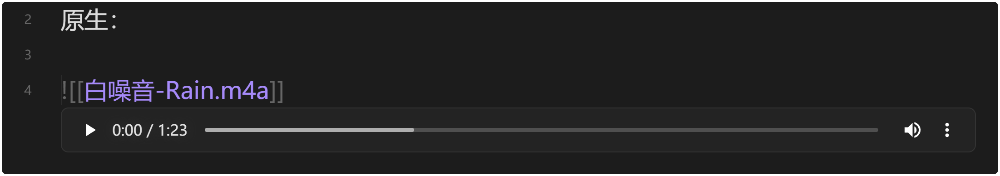
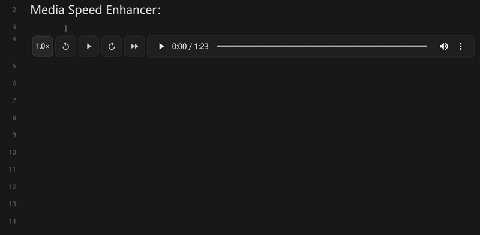
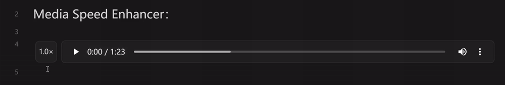

# Media Speed Enhancer

**English** | [简体中文](README.md)

<b>A minimal enhancement toolbar layered on top of Obsidian's native HTML5 audio/video players: skip back / skip forward / hold-to-speed / speed menu. Minimal intrusion, native UI untouched.</b>

## Features

| Control | Behavior |
| --- | --- |
| Current-speed badge | Always visible at the left of the player (e.g. `1.5×`); click or right-click opens the speed menu |
| `←` / `→` skip buttons | Jump back / forward by N seconds (1–60, configurable, default 5) |
| Hold-to-speed | Immediately switch to a temporary speed (default 2.0×) while pressed; restore the previous playbackRate on release |
| Play / Pause | Optional extra play/pause button (off by default) |

Extras:

- **Speed menu** — pick a permanent speed from a fully customizable list (0.25×–4.0×).
- **Commands & hotkeys** — 4 commands with no default hotkeys; bind your own in Settings → Hotkeys.
- **Global speed sync** (optional) — applying a speed to one media element applies it to all open media.
- **Minimum duration filter** (optional) — leave short sound effects untouched.
- **Auto-play next** (optional) — when one audio ends, play the next audio in the same note.

## Demo

The native player (for comparison):

Enhanced (skip buttons / hold-to-speed / current-speed badge):

## Installation

In Obsidian, open **Settings → Community plugins → Browse**, search for `Media Speed Enhancer`, install and enable it.

Manual installation: download `main.js`, `manifest.json` and `styles.css` from the [latest release](https://github.com/liyifan2004/obsidian-media-speed-enhancer/releases/latest), drop them into `.obsidian/plugins/media-speed-enhancer/`, then reload Obsidian.

Compatibility: Obsidian 1.5.0+ (desktop and mobile).

## Usage

Once enabled, every `<audio>` / `<video>` element embedded in the vault (Markdown embeds, Live Preview, Canvas, etc.) automatically gets the toolbar. The toolbar is auto-hidden by default (expands on hover); turn that off in settings to keep it always expanded.

## Documentation

- [User guide](docs/user-guide.en.md) — the full story: settings, known limitations, technical notes, development
- [Changelog](https://github.com/liyifan2004/obsidian-media-speed-enhancer/releases)
- [Issue tracker](https://github.com/liyifan2004/obsidian-media-speed-enhancer/issues)

## License

[MIT](LICENSE)
