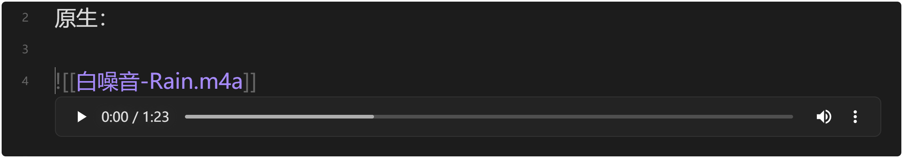
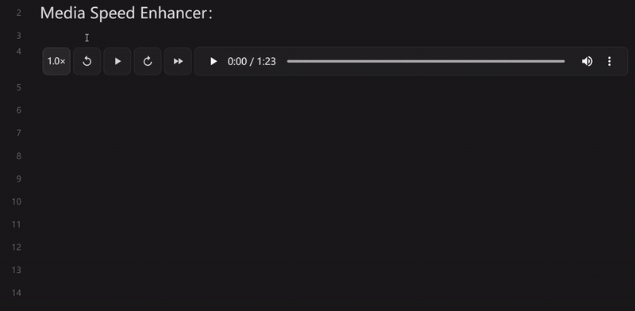
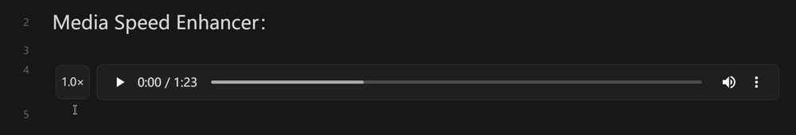

# Media Speed Enhancer

[English](README.en.md) | **简体中文**

<b>在 Obsidian 原生 HTML5 音频/视频播放器上叠加极简的增强工具栏：后退 / 前进 / 按住倍速 / 倍速菜单。最小侵入、不替换原生 UI。</b>

## 功能

| 控件 | 行为 |
| --- | --- |
| 当前倍速徽标 | 始终显示在播放器左侧（如 `1.5×`）；单击 / 右键弹出倍速菜单 |
| `←` / `→` 跳转按钮 | 后退 / 前进 N 秒（1–60 可配置，默认 5 秒） |
| 按住倍速 | 按下立即切到临时倍速（默认 2.0×）；松开恢复到按下前的 playbackRate |
| 播放 / 暂停 | 可选的额外播放/暂停按钮（默认关闭） |

其它能力：

- **倍速菜单** — 从完全自定义的倍速列表（0.25×–4.0×）中选择永久倍速。
- **命令与快捷键** — 4 个命令，不带默认快捷键，在 设置 → 快捷键 中自行绑定。
- **全局倍速同步**（可选）— 调整任意媒体的倍速时同步到所有打开的媒体。
- **最短时长过滤**（可选）— 不给短音效注入按钮。
- **顺序播放**（可选）— 当前音频播完自动播放同一笔记中的下一个音频。

## 演示

原生播放器（对照）：

增强后（跳转按钮 / 按住倍速 / 当前倍速徽标）：

## 安装

在 Obsidian 中打开 **设置 → 第三方插件 → 浏览**，搜索 `Media Speed Enhancer`，安装并启用。

手动安装：从 [最新版本](https://github.com/liyifan2004/obsidian-media-speed-enhancer/releases/latest) 下载 `main.js`、`manifest.json`、`styles.css`，放入 `.obsidian/plugins/media-speed-enhancer/` 后重新加载 Obsidian。

兼容性：Obsidian 1.5.0+（桌面 + 移动端均可）。

## 使用方法

启用后，所有 Vault 内嵌的 `<audio>` 与 `<video>` 元素（Markdown 嵌入、Live Preview、Canvas 等位置）会自动获得工具栏。工具栏默认自动隐藏（鼠标移入展开），可在设置中关闭该行为让它常驻。

## 文档

- [使用指南](docs/user-guide.md) —— 完整说明：设置项、已知限制、技术原理、开发
- [更新日志](https://github.com/liyifan2004/obsidian-media-speed-enhancer/releases)
- [问题反馈](https://github.com/liyifan2004/obsidian-media-speed-enhancer/issues)

## 许可证

[MIT](LICENSE)
