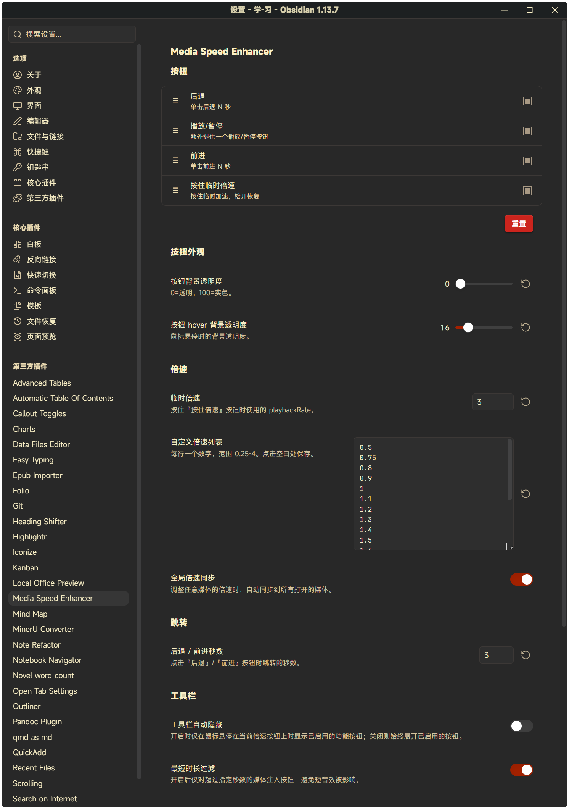

# Media Speed Enhancer User Guide

> This is the complete documentation. The README only carries the intro and the most common entry points — details live here.

## Controls

| Control | Behavior |
| --- | --- |
| Current-speed badge | Always visible at the left of the player (e.g. `1.5×`); click or right-click opens the speed menu |
| `←` / `→` skip buttons | Jump back / forward by N seconds (1–60, configurable, default 5) |
| Hold-to-speed | Immediately switch to a temporary speed (default 2.0×) while pressed; restore the previous playbackRate on release |
| Play / Pause | Optional extra play/pause button (off by default) |

Extras:

- **Speed menu** — pick a permanent speed from a fully customizable list (0.25×–4.0×).
- **Commands & hotkeys** — 4 commands (skip back, skip forward, toggle temporary speed, play/pause) with no default hotkeys; bind your own in Settings → Hotkeys.
- **Global speed sync** (optional) — applying a speed to one media element applies it to all open media.
- **Minimum duration filter** (optional) — leave short sound effects untouched.
- **Auto-play next** (optional) — when one audio ends, play the next audio in the same note (with an optional 660 Hz chime).

## Usage

Once enabled, every `<audio>` / `<video>` element embedded in the vault (Markdown embeds, Live Preview, Canvas, etc.) automatically gets the toolbar.

- The toolbar is **auto-hidden** by default: it expands when the mouse enters the controls area and collapses to the current-speed badge when the mouse leaves.
- Turn off **Auto-hide toolbar** in settings to keep it always expanded.

## Settings

Open Obsidian → Settings → Media Speed Enhancer:



| Setting | Description | Default |
| --- | --- | --- |
| Buttons | Drag to reorder, tick to enable: skip back / skip forward / hold-to-speed / play-pause | first 3 on |
| Button background opacity | 0 = transparent, 100 = solid | `6` |
| Button hover opacity | Background opacity while hovered | `16` |
| Temporary speed | playbackRate while the hold-to-speed button is pressed, 0.25–4.0 | `2.0` |
| Custom speed list | One number per line (0.25–4.0); duplicates removed, sorted ascending | 0.5 … 3.0 preset |
| Global speed sync | Sync speed changes to all open media | off |
| Skip back / forward seconds | Seconds jumped by the skip buttons, 1–60 | `5` |
| Auto-hide toolbar | Expand buttons on hover only | on |
| Minimum duration filter | Only inject buttons into media longer than N seconds | off (`30`) |
| Auto-play next | Play the next audio in the same note when the current one ends | off |
| Switch chime | 660 Hz chime on auto-advance | on |
| Touch optimization | Use pointer events for touch screens | on |

## Known limitations

1. **The native Shadow DOM control bar cannot be injected into** — all enhancements live in a separate toolbar, visually detached from the native bar.
2. **Native audio controls are often hidden by default** (browser-dependent); this plugin's toolbar is always available, so playback stays fully controllable either way.
3. **No injection into third-party embeds** (YouTube iframes etc.) — cross-origin restrictions, by design.

## Technical notes

### Why a side toolbar instead of an overlay?

The native HTML5 `<audio controls>` / `<video controls>` bar is rendered by the browser inside a **Shadow DOM**; external JS cannot reach its internals. That is Web-spec behavior, not an Obsidian quirk.

All controls sit as **flex items to the left of** the `audio`/`video` element, vertically centered; the media element itself shrinks to make room. As a result:

- The native player is never modified or replaced
- Nothing above the native bar gets covered
- Automatically adapts to any Obsidian theme (CSS variables)
- No third-party player library involved

### MutationObserver + polling fallback

The plugin watches `document.body` and `app.workspace.containerEl` (subtree/childList) and injects the toolbar into every new `<audio>` / `<video>`, recursively scanning inside added nodes (so a wholesale parent replacement never hides media). Injected elements are tracked in a `WeakMap`, which survives re-renders and supports re-mounting.

Skipped targets: media inside iframes (YouTube and other third-party embeds) and elements outside the Obsidian content area. For 30 seconds after startup a full scan runs every 2 seconds as a fallback for dynamic insertions.

## Development

```bash
npm install
npm run build      # bundle to main.js (production)
npm run dev        # watch mode, auto rebuild
npm run test       # unit tests (vitest)
npm run verify     # typecheck + lint + tests + build
```

Build artifacts: `main.js` (bundled entry), `styles.css` (loaded automatically), `manifest.json` (metadata).

The speed rules (range validation, dedup, sorting, display formatting) live in
`src/speed.ts` — a pure module with no Obsidian or DOM dependency — and are
covered by `test/speed.test.ts`. Keep it that way: logic that can be tested
without a browser should not be buried in DOM code.
