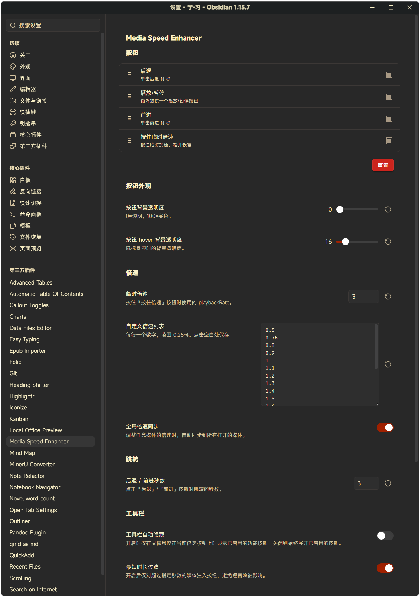

# Media Speed Enhancer 使用指南

> 本文是插件的完整说明。README 只放简介与常用入口，具体用法看这里。

## 控件

| 控件 | 行为 |
| --- | --- |
| 当前倍速徽标 | 始终显示在播放器左侧（如 `1.5×`）；单击 / 右键弹出倍速菜单 |
| `←` / `→` 跳转按钮 | 后退 / 前进 N 秒（1–60 可配置，默认 5 秒） |
| 按住倍速 | 按下立即切到临时倍速（默认 2.0×）；松开恢复到按下前的 playbackRate |
| 播放 / 暂停 | 可选的额外播放/暂停按钮（默认关闭） |

其它能力：

- **倍速菜单** — 从完全自定义的倍速列表（0.25×–4.0×）中选择永久倍速。
- **命令与快捷键** — 4 个命令（后退、前进、切换临时倍速、播放/暂停），不带默认快捷键，在 设置 → 快捷键 中自行绑定。
- **全局倍速同步**（可选）— 调整任意媒体的倍速时同步到所有打开的媒体。
- **最短时长过滤**（可选）— 不给短音效注入按钮。
- **顺序播放**（可选）— 当前音频播完自动播放同一笔记中的下一个音频（可选 660Hz 提示音）。

## 使用方法

启用后，所有 Vault 内嵌的 `<audio>` 与 `<video>` 元素（Markdown 嵌入、Live Preview、Canvas 等位置）会自动获得工具栏。

- 工具栏默认 **自动隐藏**：鼠标移入控件区展开，离开时收回到当前倍速徽标。
- 在设置中关闭 **工具栏自动隐藏** 可让工具栏常驻展开。

## 设置项

打开 Obsidian → 设置 → Media Speed Enhancer：



| 设置 | 说明 | 默认值 |
| --- | --- | --- |
| 按钮 | 拖拽排序、勾选启用：后退 / 前进 / 按住倍速 / 播放暂停 | 前 3 个开启 |
| 按钮背景透明度 | 0 = 透明，100 = 实色 | `6` |
| 按钮 hover 背景透明度 | 悬停时的背景透明度 | `16` |
| 临时倍速 | 按住『按住倍速』时使用的 playbackRate，0.25–4.0 | `2.0` |
| 自定义倍速列表 | 每行一个数字（0.25–4.0），自动去重、升序排序 | 0.5 … 3.0 预设 |
| 全局倍速同步 | 倍速变化同步到所有打开的媒体 | 关 |
| 后退 / 前进秒数 | 跳转按钮跳转的秒数，1–60 | `5` |
| 工具栏自动隐藏 | 仅 hover 时展开按钮 | 开 |
| 最短时长过滤 | 仅对超过 N 秒的媒体注入按钮 | 关（`30`） |
| 顺序播放 | 当前音频播完自动播放同笔记中的下一个 | 关 |
| 切换音频提示音 | 顺序播放切换时的 660Hz 提示音 | 开 |
| 触摸优化 | 使用 pointer events 适配触屏 | 开 |

## 已知限制

1. **无法注入原生 Shadow DOM 控制条**——所有增强都在独立工具栏中，与原生控制条视觉分离。
2. **原生音频控制条常默认隐藏**（视浏览器而定）；本插件的工具栏始终可用，播放控制不受影响。
3. **不在第三方嵌入（YouTube iframe 等）中注入**——跨域限制，设计如此。

## 关键技术说明

### 为什么是侧栏而不是覆盖层？

原生 HTML5 `<audio controls>` / `<video controls>` 的控制条由浏览器渲染在 **Shadow DOM** 中，外部 JS 无法访问其内部 DOM。这是 Web 规范决定的，与 Obsidian 无关。

所有控件作为 **flex 子项**放在 `audio`/`video` 元素的**左侧**并与之垂直居中，媒体元素本身收缩让出空间。因此：

- 完全不修改 / 不替换原生播放器
- 不遮挡原生控制条上方内容
- 自动适配 Obsidian 主题（CSS 变量）
- 不引入任何第三方播放器库

### MutationObserver + 轮询兜底

监听 `document.body` 和 `app.workspace.containerEl` 的 subtree/childList 变化，对新出现的 `<audio>` / `<video>` 自动注入工具栏，并递归扫描新增节点内部嵌套的媒体（父容器整体替换时不遗漏）。用 `WeakMap` 跟踪已注入元素，支持重渲染后的重新挂载。

跳过的目标：iframe 内（YouTube 等第三方嵌入）及 Obsidian 内容区之外的媒体。启动后 30 秒内每 2 秒全量扫描一次，兜底动态插入。

## 开发

```bash
npm install
npm run build      # 打包到 main.js（production）
npm run dev        # watch 模式，自动重建
npm run test       # 单元测试（vitest）
npm run verify     # 类型检查 + lint + 测试 + 构建
```

构建产物：`main.js`（打包入口）、`styles.css`（自动加载）、`manifest.json`（元数据）。

倍速相关的规则（取值范围校验、去重、排序、显示格式化）集中在 `src/speed.ts`
——一个不依赖 Obsidian、不碰 DOM 的纯模块——由 `test/speed.test.ts` 覆盖。
请保持这个边界：不需要浏览器就能测的逻辑，不要埋在 DOM 代码里。
